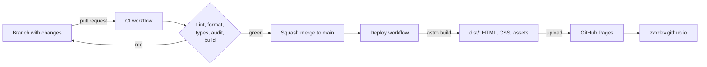

# zxxdev.github.io

Source code of my personal site: who I am, what I build and how each project works.
It is a static site built with Astro and published on GitHub Pages.

**Live site: https://zxxdev.github.io**

[](https://github.com/zxxdev/zxxdev.github.io/actions/workflows/ci.yml)
[](https://github.com/zxxdev/zxxdev.github.io/actions/workflows/deploy.yml)
[](https://github.com/zxxdev/zxxdev.github.io/actions/workflows/codeql.yml)
[](LICENSE)

> Screenshots of the home page, the project list and the mobile view will be generated by a
> script and added here once the design is in place. Until then, the live site is the demo.

## Contents

- [Why it exists](#why-it-exists)
- [What it does](#what-it-does)
- [How it works](#how-it-works)
- [Technical decisions](#technical-decisions)
- [Quality](#quality)
- [Development](#development)
- [Security and privacy](#security-and-privacy)
- [Limitations and roadmap](#limitations-and-roadmap)
- [License](#license)

## Why it exists

A CV lists technologies; it does not show how someone works. This site is the entry point to my
projects: what each one solves, how it is built and which decisions were made along the way. It is
also a project in itself, built with the same rules as the others: every change goes through a
pull request, automated checks and an automatic deployment.

## What it does

Today, the first version:

- A provisional home page, with light and dark colours that follow the system setting.
- Automatic checks on every pull request: lint, formatting, type checking, a dependency audit, a
  security scan and a full build.
- Automatic publishing to GitHub Pages on every merge to `main`.

Coming next (see [roadmap](#limitations-and-roadmap)): the visual design, the about page, project
pages written in Markdown, live data from GitHub, Spanish and English versions, end-to-end and
accessibility tests, and search.

## How it works



- **Astro** reads the pages in `src/pages/` and the layouts in `src/layouts/` and writes plain HTML
  files to `dist/`. No JavaScript is sent to the browser unless a component needs it.
- **Tailwind CSS** generates only the CSS classes that the pages actually use.
- **GitHub Actions** runs two workflows: `ci.yml` checks every pull request, and `deploy.yml` builds
  `main` and publishes it to Pages. A third one, `codeql.yml`, scans the code and the workflows.
- **GitHub Pages** only serves files. There is no server or database behind the site.

## Technical decisions

| Decision                                | Why                                                                                       | Record                                                   |
| --------------------------------------- | ----------------------------------------------------------------------------------------- | -------------------------------------------------------- |
| Astro with static output                | A content site needs HTML, not a running server: faster, cheaper and with less to secure. | [ADR 0001](docs/adr/0001-use-astro-for-a-static-site.md) |
| Strict TypeScript                       | Mistakes such as a possibly missing value are caught when building, not by a visitor.     | —                                                        |
| Actions pinned by commit SHA            | A tag can be moved to different code; a commit SHA cannot.                                | —                                                        |
| 7-day release cooldown for dependencies | Most hijacked packages are detected and removed within hours.                             | [Dependency security](#dependency-security)              |

All records: [docs/adr](docs/adr/README.md).

## Quality

| Check                 | Tool                                              | When                                    |
| --------------------- | ------------------------------------------------- | --------------------------------------- |
| Lint                  | ESLint with the strict TypeScript and Astro rules | Every pull request                      |
| Formatting            | Prettier, with the Astro and Tailwind plugins     | Every pull request                      |
| Types                 | `astro check` (TypeScript in strict mode)         | Every pull request                      |
| Known vulnerabilities | `pnpm audit`, fails on high or critical           | Every pull request and weekly           |
| Code scanning         | CodeQL for TypeScript and for the workflows       | Every pull request and weekly           |
| Build                 | `astro build`                                     | Every pull request and every deployment |

What is **not** checked yet: end-to-end tests, accessibility and performance scores. They arrive
with the tests described in the roadmap, and their badges will be generated by CI, not written by
hand.

## Development

Requirements: Node.js 26 and pnpm 12 (the exact version is pinned in `package.json`).

| Command                             | What it does                                       |
| ----------------------------------- | -------------------------------------------------- |
| `pnpm install --frozen-lockfile`    | Installs exactly the versions in `pnpm-lock.yaml`. |
| `pnpm dev`                          | Starts a local server with live reload.            |
| `pnpm lint`                         | Runs ESLint.                                       |
| `pnpm format` / `pnpm format:check` | Formats the code, or only checks it.               |
| `pnpm check`                        | Type checks the TypeScript and Astro files.        |
| `pnpm build`                        | Builds the site into `dist/`.                      |
| `pnpm preview`                      | Serves the built site locally.                     |

<details>
<summary>Folder structure</summary>

```text
.
├── .github/
│   ├── workflows/          # ci.yml, deploy.yml, codeql.yml
│   ├── ISSUE_TEMPLATE/     # bug report and suggestion forms
│   └── dependabot.yml      # weekly updates with a 7-day cooldown
├── docs/adr/               # architecture decision records
├── public/                 # files copied as they are (favicon)
├── src/
│   ├── layouts/            # the HTML shell shared by every page
│   ├── pages/              # one file per page; the path is the URL
│   └── styles/             # global CSS and Tailwind
├── astro.config.mjs
├── eslint.config.js
└── pnpm-workspace.yaml     # pnpm settings, including the supply-chain protections
```

</details>

How changes are proposed and reviewed: [CONTRIBUTING.md](CONTRIBUTING.md).

## Security and privacy

- **No tracking.** No analytics, no cookies and no requests to third-party servers when a page loads.
- **Nothing to attack on a server.** The site is a set of static files served by GitHub Pages.
- **Least privilege in CI.** Workflows only have read access by default. Only the deployment job can
  write to Pages, and only CodeQL can upload scan results. Checkouts do not keep the token.
- **Private vulnerability reports** through GitHub: see [SECURITY.md](SECURITY.md).

### Dependency security

Attacks on npm packages usually follow the same pattern: an attacker takes over a maintainer's
account, publishes a version with malware that runs on install, and it is removed a few hours
later. The settings in [`pnpm-workspace.yaml`](pnpm-workspace.yaml) are aimed at exactly that:

| Setting                                            | Effect                                                                                                         |
| -------------------------------------------------- | -------------------------------------------------------------------------------------------------------------- |
| `minimumReleaseAge: 10080`                         | No version younger than 7 days is installed.                                                                   |
| `trustPolicy: no-downgrade`                        | A version published with weaker evidence than the previous ones (for example, without provenance) is rejected. |
| `strictDepBuilds: true` and an empty `allowBuilds` | No dependency may run an install script unless it is approved one by one.                                      |
| `blockExoticSubdeps: true`                         | Indirect dependencies must come from the registry, not from git repositories or URLs.                          |
| Lockfile and `--frozen-lockfile`                   | CI installs exactly what was reviewed.                                                                         |
| Dependabot `cooldown`                              | Update pull requests also wait 7 days. Security fixes are not delayed.                                         |

## Limitations and roadmap

The site is at its first step. Planned, in order:

1. Visual design: colours, typography, light and dark mode with a switch, mobile layout.
2. Home and about pages with real content.
3. Project pages from Markdown files with a validated schema.
4. Data from the GitHub API at build time, with a cache and a fallback if the API fails.
5. Spanish and English versions.
6. End-to-end tests with Playwright, accessibility checks with axe and Lighthouse budgets.
7. Search with Pagefind, sitemap and social preview images.

Known limitations today:

- The home page is provisional and in English only.
- One moderate advisory affects a development-only tool (`minimatch`, used by ESLint). It never
  reaches the published site. The fixed versions are newer than the 7-day cooldown and will arrive
  through Dependabot.

## License

[MIT](LICENSE) © 2026 zxxdev
