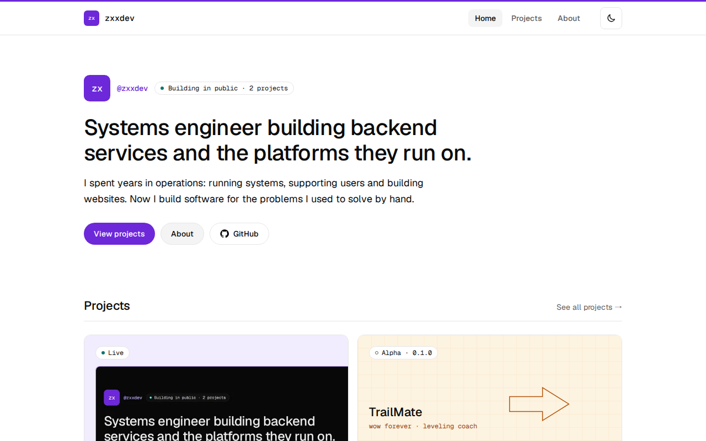
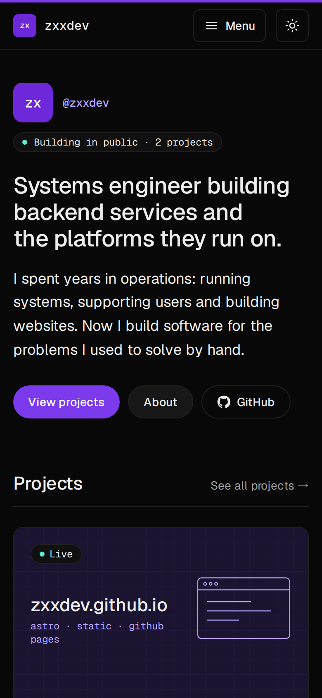
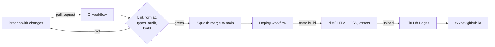

# zxxdev.github.io

Source code of my personal site: who I am, what I build and how each project works.
It is a static site built with Astro and published on GitHub Pages.

**Live site: https://zxxdev.github.io**

[](https://github.com/zxxdev/zxxdev.github.io/actions/workflows/ci.yml)
[](https://github.com/zxxdev/zxxdev.github.io/actions/workflows/deploy.yml)
[](https://github.com/zxxdev/zxxdev.github.io/actions/workflows/codeql.yml)
[](LICENSE)

<picture>
  <source media="(prefers-color-scheme: dark)" srcset="docs/images/home-dark.png">
  
</picture>

<sub>Screenshots are made by <code>scripts/screenshots.ts</code> with Playwright, never by hand.
The image follows your GitHub theme.</sub>

## Contents

- [Why it exists](#why-it-exists)
- [What it does](#what-it-does)
- [How it works](#how-it-works)
- [Technical decisions](#technical-decisions)
- [Quality](#quality)
- [Development](#development)
- [Security and privacy](#security-and-privacy)
- [Limitations and roadmap](#limitations-and-roadmap)
- [License](#license)

## Why it exists

A CV lists technologies; it does not show how someone works. This site is the entry point to my
projects: what each one solves, how it is built and which decisions were made along the way. It is
also a project in itself, built with the same rules as the others: every change goes through a
pull request, automated checks and an automatic deployment.

## What it does

Today:

- A sharp visual design: near-black and neutral greys, cards with a hairline border and no blur,
  self-hosted Geist fonts, and one colour per kind of project from a closed list.
- Light and dark themes. The site follows the system setting until the visitor picks one with the
  switch; the choice is remembered and applied before the page is drawn, so there is no flash.
- A header with the main navigation, which folds into a menu button on small screens, a skip link
  for keyboard users, a footer and a "page not found" page.
- A home page with the headline, the featured projects, how I work and the technologies the
  projects use, and an About page with the story and the path so far. Their text lives in a typed
  data file (`src/data/profile.ts`), not in the markup.
- Projects written as Markdown files, one per project, checked against a schema while building: a
  missing field, an unknown technology or an early version without its number stops the build and
  says where. Adding a project is adding a file.
- A Projects page with every project and a filter by technology (`/projects/?tech=lua`), and a page
  per project with what it solves, how it works, the decisions behind it and its stack.
- Project cards with a real screenshot as the cover when the project has one, or a cover generated
  in the project's colour until then, and a status tag built from the version the project declares
  (for now copied into the project file; reading it from GitHub comes with the live data).
- An About page with links to its sections, which mark the one being read, and the Azure exams
  passed.
- Automatic checks on every pull request: lint, formatting, type checking, unit tests, a dependency
  audit, a security scan and a full build.
- Automatic publishing to GitHub Pages on every merge to `main`.



<sub>The home page on a 390 px wide phone.</sub>

Coming next (see [roadmap](#limitations-and-roadmap)): live data from GitHub, Spanish and English versions, end-to-end and accessibility tests, and search.

## How it works



- **Astro** reads the pages in `src/pages/` and the layouts in `src/layouts/` and writes plain HTML
  files to `dist/`. No JavaScript is sent to the browser unless a component needs it.
- **Tailwind CSS** generates only the CSS classes that the pages actually use.
- **GitHub Actions** runs two workflows: `ci.yml` checks every pull request, and `deploy.yml` builds
  `main` and publishes it to Pages. A third one, `codeql.yml`, scans the code and the workflows.
- **GitHub Pages** only serves files. There is no server or database behind the site.

More detail, including how a page is put together: [docs/architecture.md](docs/architecture.md).

## Technical decisions

| Decision                                | Why                                                                                       | Record                                                        |
| --------------------------------------- | ----------------------------------------------------------------------------------------- | ------------------------------------------------------------- |
| Astro with static output                | A content site needs HTML, not a running server: faster, cheaper and with less to secure. | [ADR 0001](docs/adr/0001-use-astro-for-a-static-site.md)      |
| Design tokens and themes                | Colours are named and defined once; pages use names, so dark mode needs no extra classes. | [ADR 0002](docs/adr/0002-design-tokens-and-theme.md)          |
| Self-hosted fonts                       | No request to a font server: the visitor's IP stays here and nothing else must be online. | [ADR 0002](docs/adr/0002-design-tokens-and-theme.md)          |
| Sharp look, one colour per project kind | Nothing blurred, and colour that means something instead of decoration.                   | [ADR 0003](docs/adr/0003-sharp-redesign-and-project-tones.md) |
| Projects as Markdown with a schema | Adding a project is adding a file, and a broken file stops the build instead of the page. | [ADR 0004](docs/adr/0004-projects-as-a-content-collection.md) |
| Strict TypeScript                       | Mistakes such as a possibly missing value are caught when building, not by a visitor.     | —                                                             |
| Actions pinned by commit SHA            | A tag can be moved to different code; a commit SHA cannot.                                | —                                                             |
| 7-day release cooldown for dependencies | A hijacked version is usually caught and removed before a week has passed.                | [Dependency security](#dependency-security)                   |

All records: [docs/adr](docs/adr/README.md).

## Quality

| Check                 | Tool                                              | When                                    |
| --------------------- | ------------------------------------------------- | --------------------------------------- |
| Lint                  | ESLint with the strict TypeScript and Astro rules | Every pull request                      |
| Formatting            | Prettier, with the Astro and Tailwind plugins     | Every pull request                      |
| Types                 | `astro check` (TypeScript in strict mode)         | Every pull request                      |
| Unit tests            | Vitest: the project schema, the list helpers and the top-level routes | Every pull request |
| Project data          | The content schema, while building                | Every pull request and every deployment |
| Known vulnerabilities | `pnpm audit`, fails on high or critical           | Every pull request and weekly           |
| Code scanning         | CodeQL for TypeScript and for the workflows       | Every pull request and weekly           |
| Build                 | `astro build`                                     | Every pull request and every deployment |

What is **not** checked yet: end-to-end tests, accessibility and performance scores. They arrive
with the tests described in the roadmap, and their badges will be generated by CI, not written by
hand.

## Development

Requirements: Node.js 26 and pnpm 12 (the exact version is pinned in `package.json`).

| Command                             | What it does                                       |
| ----------------------------------- | -------------------------------------------------- |
| `pnpm install --frozen-lockfile`    | Installs exactly the versions in `pnpm-lock.yaml`. |
| `pnpm dev`                          | Starts a local server with live reload.            |
| `pnpm lint`                         | Runs ESLint.                                       |
| `pnpm format` / `pnpm format:check` | Formats the code, or only checks it.               |
| `pnpm check`                        | Type checks the TypeScript and Astro files.        |
| `pnpm test`                         | Runs the unit tests (Vitest).                      |
| `pnpm build`                        | Builds the site into `dist/`.                      |
| `pnpm preview`                      | Serves the built site locally.                     |
| `pnpm screenshots`                  | Remakes the screenshots from the running preview.  |

<details>
<summary>Folder structure</summary>

```text
.
├── .github/
│   ├── workflows/          # ci.yml, deploy.yml, codeql.yml
│   ├── ISSUE_TEMPLATE/     # bug report and suggestion forms
│   └── dependabot.yml      # weekly updates with a 7-day cooldown
├── docs/
│   ├── adr/                # architecture decision records
│   ├── images/             # README screenshots, made by scripts/screenshots.ts
│   └── architecture.md     # how the site is built and published
├── public/                 # files copied as they are (favicon)
├── scripts/
│   └── screenshots.ts      # Playwright: takes the screenshots from the running preview
├── src/
│   ├── assets/projects/    # project cover screenshots, optimised by Astro when building
│   ├── components/         # header, footer, theme switch, project card and cover, avatar
│   ├── content/projects/   # one Markdown file per project: its data and its page's text
│   ├── content.config.ts   # the projects collection and its schema
│   ├── data/               # navigation, technologies, tones, home and about page content
│   ├── layouts/            # the HTML shell shared by every page
│   ├── lib/                # the project schema and list helpers, kept apart for unit tests
│   ├── pages/              # one file per page; the path is the URL ([id] makes one per project)
│   ├── scripts/            # browser code (theme handling)
│   └── styles/             # design tokens, fonts and Tailwind
├── tests/                  # unit tests (Vitest)
├── astro.config.mjs
├── eslint.config.js
└── pnpm-workspace.yaml     # pnpm settings, including the supply-chain protections
```

</details>

How changes are proposed and reviewed: [CONTRIBUTING.md](CONTRIBUTING.md). Rules for issues and
pull requests: [CODE_OF_CONDUCT.md](CODE_OF_CONDUCT.md).

## Security and privacy

- **No tracking.** No analytics, no cookies and no requests to third-party servers when a page loads.
- **Nothing to attack on a server.** The site is a set of static files served by GitHub Pages.
- **Least privilege in CI.** Workflows only have read access by default. Only the deployment job can
  write to Pages, and only CodeQL can upload scan results. Checkouts do not keep the token.
- **Private vulnerability reports** through GitHub: see [SECURITY.md](SECURITY.md).

### Dependency security

Attacks on npm packages usually follow the same pattern: an attacker takes over a maintainer's
account and publishes a version with malware that runs on install. It stays available until
someone detects it, usually within hours or days (see pnpm's
[supply-chain security guide](https://pnpm.io/supply-chain-security)). The settings in
[`pnpm-workspace.yaml`](pnpm-workspace.yaml) are aimed at exactly that:

| Setting                                   | Effect                                                                                                         |
| ----------------------------------------- | -------------------------------------------------------------------------------------------------------------- |
| `minimumReleaseAge: 10080`                | No version younger than 7 days is installed.                                                                   |
| `trustPolicy: no-downgrade`               | A version published with weaker evidence than the previous ones (for example, without provenance) is rejected. |
| `strictDepBuilds: true` and `allowBuilds` | No dependency may run an install script unless it is approved one by one. Today none is approved.              |
| `blockExoticSubdeps: true`                | Indirect dependencies must come from the registry, not from git repositories or URLs.                          |
| Lockfile and `--frozen-lockfile`          | CI installs exactly what was reviewed.                                                                         |
| Dependabot `cooldown`                     | Update pull requests also wait 7 days.                                                                         |

Dependabot opens security updates without waiting, but pnpm still refuses a version younger than 7
days. When a security fix cannot wait, the exception is added explicitly
(`minimumReleaseAgeExclude`) and explained in the pull request.

## Limitations and roadmap

Done so far: the pipeline (checks and deployment), the visual design, the home and about pages, and
the projects as Markdown files with their own pages. Planned, in order:

1. Data from the GitHub API at build time, with a cache and a fallback if the API fails.
2. Spanish and English versions.
3. End-to-end tests with Playwright, accessibility checks with axe and Lighthouse budgets.
4. Search with Pagefind, sitemap and social preview images.

Known limitations today:

- The site is in English only. TrailMate keeps a generated cover until there are in-game
  screenshots without character or realm names.
- Screenshots are remade by running the script, not on every build: after a design change, they
  are out of date until someone runs `pnpm screenshots`.
- The test that keeps top-level routes clear of repository names only knows the repositories that
  have a project file (and the profile repository). It will use the account's full list once the
  site reads it from the GitHub API.
- The project pages have no architecture diagram yet; each one links to its repository's
  documentation instead.
- Contrast was measured when the colours were chosen, but it is not yet checked automatically; that
  comes with the accessibility tests.
- Open dependency advisories, if any, are tracked as issues with the
  [`chore` label](https://github.com/zxxdev/zxxdev.github.io/issues?q=is%3Aopen+label%3Achore).

## License

[MIT](LICENSE) © 2026 zxxdev
