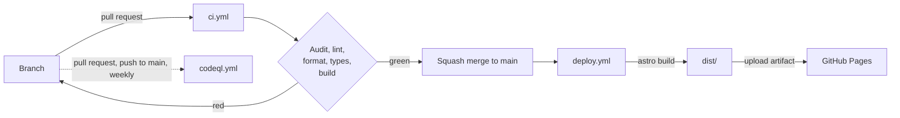
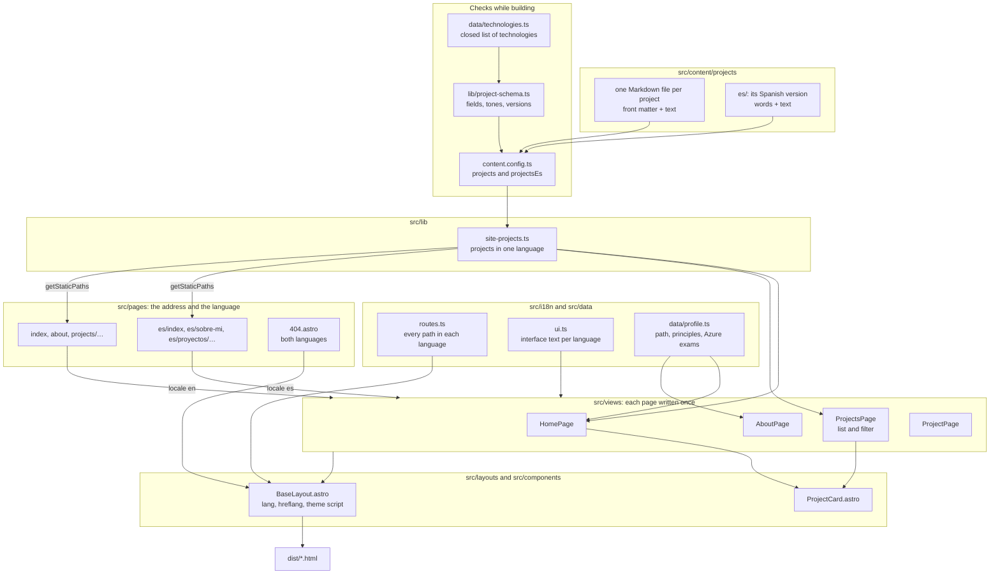
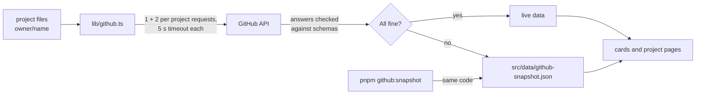

# Architecture

The site is a set of static files. Everything happens at build time: Astro turns the pages, the data
files and the styles into HTML and CSS, and GitHub Pages serves the result. There is no server code,
database or API behind it. The only outside call is to the GitHub API, made by the build, never by
the visitor's browser.

## From a change to the live site

- `ci.yml` runs on every pull request, on every push to `main` and once a week, because new
  vulnerabilities are published after dependencies are installed.
- `deploy.yml` runs on every push to `main`, every day (so a new repository appears on the site by
  the next day, and the GitHub data is at most a day old), and can also be started by hand from the Actions tab (`workflow_dispatch`) to republish
  `main` without a new change. It is the only workflow that can
  write to Pages. Its build job has read access only; the deploy job gets `pages: write` and
  `id-token: write`, and nothing else.
- `codeql.yml` scans the TypeScript code and the workflows themselves.

## How a page is built

The header (with the language switch), footer, theme switch, avatar, icons, status tags, covers
and technology pills are left out of the diagram: every page gets them through `BaseLayout.astro` or
uses them directly.

- **Two languages, each page written once.** The markup of every page is a component in
  `src/views/` that takes the language. The files in `src/pages/` only choose the address and the
  language: `/about/` and `/es/sobre-mi/` render the same view. Paths come from
  `src/i18n/routes.ts` and words from `src/i18n/ui.ts`, never from the markup. English keeps the
  addresses it had before Spanish existed. Why: [ADR 0007](adr/0007-spanish-and-english.md).

- **Projects are Markdown files checked by a schema.** Each file in `src/content/projects/` is one
  project: the front matter holds its data (title, repository, tone, status, stack, cover) and the
  body is the text of its page. While building, Astro checks every file against
  `src/lib/project-schema.ts`; a missing or misspelt field, an unknown tone or technology, or an
  early project without a version stops the build and names the file and the field. Why:
  [ADR 0004](adr/0004-projects-as-a-content-collection.md).
  Its Spanish version, with the same name in `src/content/projects/es/`, holds only the words and
  the page's text; the build stops if one of the pair is missing.
- **One page per project and language, made while building.** `projects/[id].astro` and
  `es/proyectos/[id].astro` return one page per project from `getStaticPaths`, at
  `/projects/<id>/` and `/es/proyectos/<id>/`. Nothing is decided by a server later. Project pages
  are never at the top level: GitHub serves each repository's own Pages site at
  `zxxdev.github.io/<repo>/`, and a unit test fails if a top-level route takes a repository's name.
- **Lists are built from the data.** The home page shows the projects marked `featured` and the
  technologies some project uses, grouped as in `src/data/technologies.ts`. The project count in the
  status pill is counted, not typed.
- **Pages decide how things look; data files hold what they say.** The path on the About page, the
  "How I work" points and the Azure exams are typed arrays in `src/data/profile.ts`.
- **One layout for every page.** `BaseLayout.astro` writes the `<head>` (with `<html lang>` and the
  page's other-language version as `hreflang`), applies a saved theme before the page is painted,
  preloads the main font and adds the header and footer. On the English home page only, it also
  sends a visitor whose browser prefers Spanish to `/es/`, unless they chose a language already.
- **JavaScript only where it is needed.** The theme switch, the mobile menu, the language switch
  (only to remember the choice) and the filter on the Projects page ship a few lines of script each. Without JavaScript the menu stays a row of links
  and the Projects page shows the full list; everything else is plain HTML and CSS.

## Design

Colours, type sizes and corners are design tokens defined once in `src/styles/global.css`, each with
its light and dark value side by side (`light-dark()`). Tailwind generates utility classes from them,
so pages use names such as `text-muted` and never a colour code. Why it is done this way:
[ADR 0002](adr/0002-design-tokens-and-theme.md).

Each project has a **tone** from a closed list (`violet`, `cobalt`, `teal`, `amber`), listed in
`src/data/tones.ts`. A card or a project page sets `data-tone`, and `global.css` turns that into four colours
(`--tone-bg`, `--tone-grid`, `--tone-line`, `--tone-text`) used by its cover and by its border on
hover. The How I work icons and the About timeline reuse the same tones by meaning. Until a project
has a screenshot, `ProjectCover.astro` draws its cover as an inline SVG from
the same data, so there are no image files to keep in sync. Why the look is flat and sharp:
[ADR 0003](adr/0003-sharp-redesign-and-project-tones.md).

## GitHub data

- `src/lib/github.ts` asks for the account's repository list, then each project's languages and
  latest release. It is fetched once per build (`src/lib/github-data.ts`) and shared by every page.
- If any request fails, times out or returns something unexpected, the whole saved copy is used. A
  page never mixes fresh and saved figures; a note under them says which one it shows and its date.
- In GitHub Actions the build uses the run's own read-only token (`GITHUB_TOKEN`). It stays on the
  build machine. `GITHUB_DATA=snapshot` skips the network, for a build with no connection.
- Why it works this way: [ADR 0005](adr/0005-github-data-at-build-time.md).
