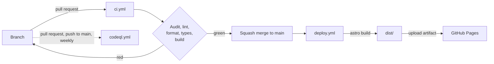
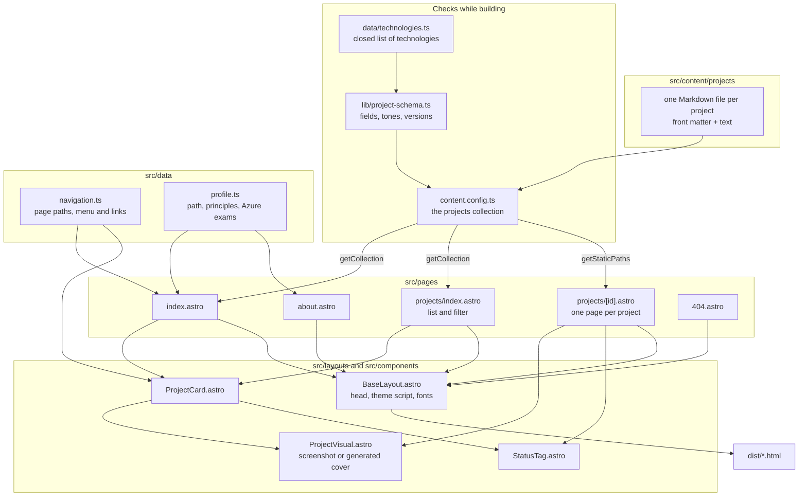

# Architecture

The site is a set of static files. Everything happens at build time: Astro turns the pages, the data
files and the styles into HTML and CSS, and GitHub Pages serves the result. There is no server code,
database or API behind it.

## From a change to the live site

- `ci.yml` runs on every pull request, on every push to `main` and once a week, because new
  vulnerabilities are published after dependencies are installed.
- `deploy.yml` runs on every push to `main`, and can also be started by hand from the Actions tab
  (`workflow_dispatch`) to republish `main` without a new change. It is the only workflow that can
  write to Pages. Its build job has read access only; the deploy job gets `pages: write` and
  `id-token: write`, and nothing else.
- `codeql.yml` scans the TypeScript code and the workflows themselves.

## How a page is built

The header, footer, theme switch, avatar, icons and technology pills are left out of the diagram:
every page gets them through `BaseLayout.astro` or uses them directly.

- **Projects are Markdown files checked by a schema.** Each file in `src/content/projects/` is one
  project: the front matter holds its data (title, repository, tone, status, stack, cover) and the
  body is the text of its page. While building, Astro checks every file against
  `src/lib/project-schema.ts`; a missing or misspelt field, an unknown tone or technology, or an
  early project without a version stops the build and names the file and the field. Why:
  [ADR 0004](adr/0004-projects-as-a-content-collection.md).
- **One page per project, made while building.** `projects/[id].astro` returns one page per file
  from `getStaticPaths`, at `/projects/<id>/`. Nothing is decided by a server later. Project pages
  are never at the top level: GitHub serves each repository's own Pages site at
  `zxxdev.github.io/<repo>/`, and a unit test fails if a top-level route takes a repository's name.
- **Lists are built from the data.** The home page shows the projects marked `featured` and the
  technologies some project uses, grouped as in `src/data/technologies.ts`. The project count in the
  status pill is counted, not typed.
- **Pages decide how things look; data files hold what they say.** The path on the About page, the
  "How I work" points and the Azure exams are typed arrays in `src/data/profile.ts`.
- **One layout for every page.** `BaseLayout.astro` writes the `<head>`, applies a saved theme before
  the page is painted, preloads the main font and adds the header and footer.
- **JavaScript only where it is needed.** The theme switch, the mobile menu and the filter on the
  Projects page ship a few lines of script each. Without JavaScript the menu stays a row of links
  and the Projects page shows the full list; everything else is plain HTML and CSS.

## Design

Colours, type sizes and corners are design tokens defined once in `src/styles/global.css`, each with
its light and dark value side by side (`light-dark()`). Tailwind generates utility classes from them,
so pages use names such as `text-muted` and never a colour code. Why it is done this way:
[ADR 0002](adr/0002-design-tokens-and-theme.md).

Each project has a **tone** from a closed list (`violet`, `cobalt`, `teal`, `amber`), listed in
`src/data/tones.ts`. A card or a project page sets `data-tone`, and `global.css` turns that into four colours
(`--tone-bg`, `--tone-grid`, `--tone-line`, `--tone-text`) used by its cover and by its border on
hover. The How I work icons and the About timeline reuse the same tones by meaning. Until a project
has a screenshot, `ProjectCover.astro` draws its cover as an inline SVG from
the same data, so there are no image files to keep in sync. Why the look is flat and sharp:
[ADR 0003](adr/0003-sharp-redesign-and-project-tones.md).

## What changes later

- **GitHub data** (languages, last change, releases) is fetched at build time, with a cache and a
  fallback so a failing API never breaks a deployment.
- **Languages:** Spanish and English, each with its own path (`/es/…`, `/en/…`).
