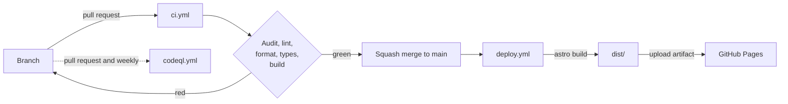
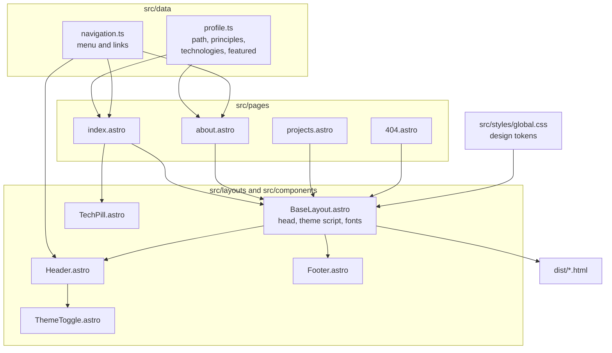

# Architecture

The site is a set of static files. Everything happens at build time: Astro turns the pages, the data
files and the styles into HTML and CSS, and GitHub Pages serves the result. There is no server code,
database or API behind it.

## From a change to the live site

- `ci.yml` runs on every pull request, on every push to `main` and once a week, because new
  vulnerabilities are published after dependencies are installed.
- `deploy.yml` is the only workflow that can write to Pages. Its build job has read access only; the
  deploy job gets `pages: write` and nothing else.
- `codeql.yml` scans the TypeScript code and the workflows themselves.

## How a page is built

- **Pages decide how things look; data files hold what they say.** The path on the About page, the
  "How I work" points, the technologies and the featured projects are typed arrays in
  `src/data/profile.ts`. Changing a line of content does not touch the markup, and a missing field is
  a type error at build time.
- **One layout for every page.** `BaseLayout.astro` writes the `<head>`, applies a saved theme before
  the page is painted, preloads the main font and adds the header and footer.
- **JavaScript only where it is needed.** The theme switch and the mobile menu ship a few lines of
  script each. Everything else is plain HTML and CSS, and works with JavaScript turned off.

## Design

Colours, type sizes and corners are design tokens defined once in `src/styles/global.css`, each with
its light and dark value side by side (`light-dark()`). Tailwind generates utility classes from them,
so pages use names such as `text-muted` and never a colour code. Why it is done this way:
[ADR 0002](adr/0002-design-tokens-and-theme.md).

## What changes later

- **Projects** become Markdown files with a validated schema, and the technologies list is built
  from them instead of being listed by hand.
- **GitHub data** (languages, last change, releases) is fetched at build time, with a cache and a
  fallback so a failing API never breaks a deployment.
- **Languages:** Spanish and English, each with its own path (`/es/…`, `/en/…`).
